[itsfizys.gg](https://itsfizys.gg) &nbsp;·&nbsp;
[discord](https://discord.gg/aerox) &nbsp;·&nbsp;
[youtube](https://youtube.com/@aeroxdevs) &nbsp;·&nbsp;
[instagram](https://www.instagram.com/aeroxdevs)

Student developer and founder of [AeroX](https://discord.gg/aerox), a developer community built around turning ideas into real things.

I build Discord bots and the tooling around them. Most of what I ship lives inside [AeroX Development](https://github.com/AeroXDevs), a 7k+ member community where ideas go from concept to commit.

<samp>javascript &nbsp; typescript &nbsp; discord.js &nbsp; node &nbsp; python &nbsp; mongodb &nbsp; docker &nbsp; git &nbsp; linux</samp>

**[Hedwig](https://hedwig.site)** &nbsp;·&nbsp; <samp>Discord.js, TypeScript</samp> 
A multipurpose Discord bot anyone can invite and use in their server.

**[piccdn](https://github.com/itsfizys/piccdn)** &nbsp;·&nbsp; <samp>TypeScript, GitHub API</samp> 
A simple API for fetching images from multiple categories to use in your projects.

**[Quotes CDN](https://github.com/itsfizys/quotescdn)** &nbsp;·&nbsp; <samp>JavaScript, Node.js</samp> 
A no-key API for 25,000 quotes and author details, with search and customizable SVG quote cards.

